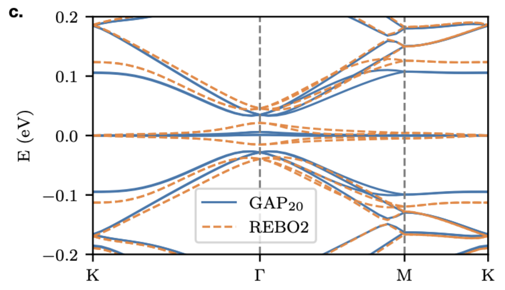
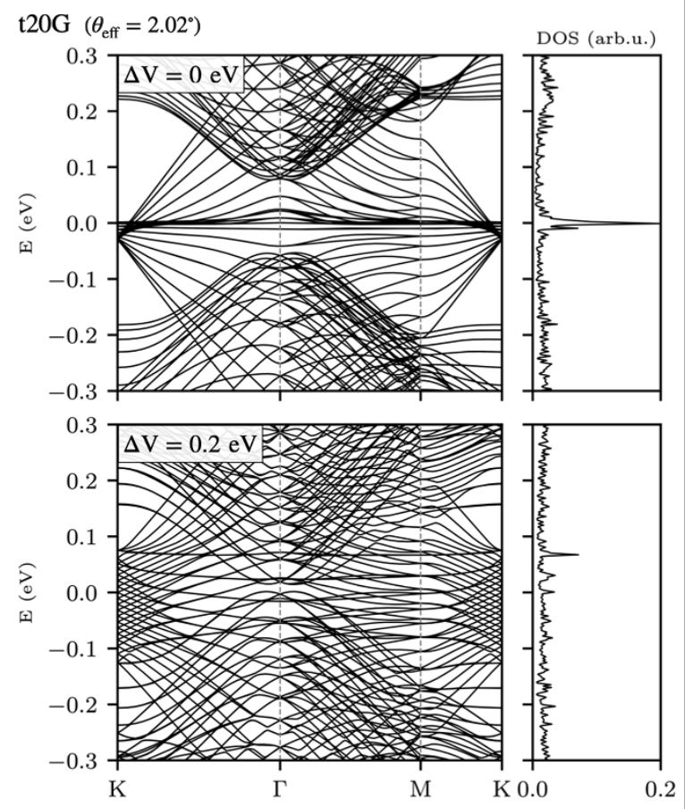
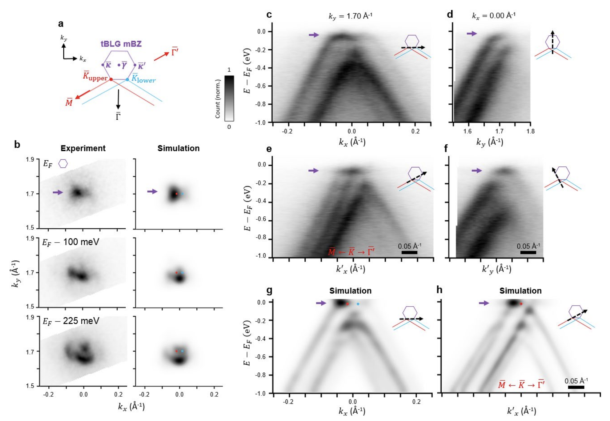

# Benchmarks

Validation of GRABNES against reference calculations and experiments.

## Magic angle renormalization in twisted bilayer graphene

We can calculate the electronic bandstructure of twisted bilayer graphene
where we used our SHE model which is an improved Two-Center (TC) model which
has been optimized to capture the DFT Tunneling at the K-point while allowing
the user to tune it to capture the magic angle at a specific value. Here we
set S so that the magic angle occurs at 1.08 degree when using the relaxed
structures from an energy minimization using LAMMPS based on
EXX-RPA-informed registry-dependent force fields. The intralayer terms used
here in LAMMPS are either the widely used REBO2 forcefields or the
machine-learning based GAP20 potential.



## Twisted multilayer graphene electric bandstructures

A wide variety of layered materials can be considered in GRABNES. Here we
implemented the Hamiltonian part of the code in such a way that a 20 layers
twisted graphene system clearly showing the family of tBG bands that are
expected in such tNG system. A flag in the GRABNES input file can be added to
activate a perpendicular electric field.



## Twisted bilayer graphene: band-unfolding

Our code allows to calculate the band-unfolded band structures that can help
to understand experimental ARPES measurements. Here we observe good agreement
between the experimental features obtained using nano-ARPES and simulated
features obtained using our package.



Comparison of experimental ARPES data with simulated band unfolded data using
GRABNES. Figure published in
[Nature Physics](https://www.nature.com/articles/s41567-020-0974-x).

## Graphene on h-BN: gap estimation

```{admonition} Coming soon
This benchmark is not yet documented.
```

## h-BN encapsulated graphene: supermoire features

```{admonition} Coming soon
This benchmark is not yet documented.
```

## Percolating Impurity States in Defected Graphene

```{admonition} Coming soon
This benchmark is not yet documented.
```
