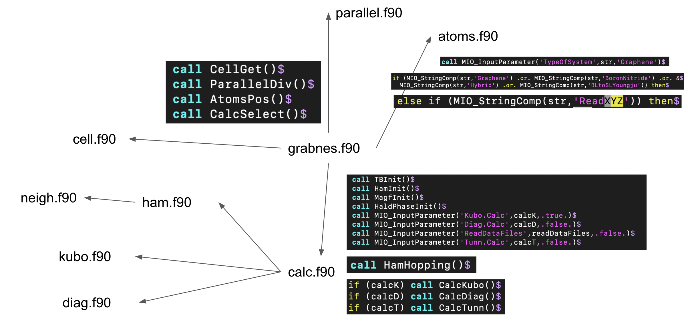

# Development guide

The Fortran sources live in the `Src/` folder of the GRABNES code
repository; this page gives an overview of how the code is organized.

## Code structure

The main interactions between the modules of the code are illustrated below.



## Modules

The program and modules making up the code:

| Source file | Role |
|---|---|
| `grabnes.f90` | Main program |
| `atoms.f90` | Atoms and structure generation |
| `cell.f90` | Cell construction |
| `neigh.f90` | Neighbor lists |
| `ham.f90` | Hamiltonian construction |
| `hybrid.f90` | Hybrid F2G2/TC models |
| `tbpar.f90` | Tight-binding parameters |
| `diag.f90` | Exact diagonalization |
| `calc.f90` | Observables |
| `kubo.f90`, `kuboarrays.f90`, `kubosubs.f90` | Kubo–Greenwood transport |
| `magf.f90` | Magnetic field |
| `scf.f90` | Self-consistency |
| `gauss.f90` | Gauss law / Poisson |
| `interface.f90` | External interfaces (e.g. LAMMPS) |
| `parallel.f90` | OMP parallelization |
| `random.f90` | Random number generation |
| `constants.f90` | Physical constants |
| `math.f90` | Math utilities |
| `name.f90` | Run naming |
| `version.f90` | Version information |

The module-level API documentation (generated from the sources) is a work in
progress — see {doc}`../reference/index`.

## Finding your way around the source

The quickest way to understand what an input flag does is to grep the sources
for it:

```bash
grep -r "SuperCell ." Src/
```

This lists all occurrences of the flag and the routines that consume it.

## Building for development

Follow the {doc}`../installation` instructions; the build is driven by
`make.sys`. The code is parallelized with OpenMP.

```{todo}
This section is a work in progress. Planned additions: coding style, testing
of example inputs, and the release procedure.
```
