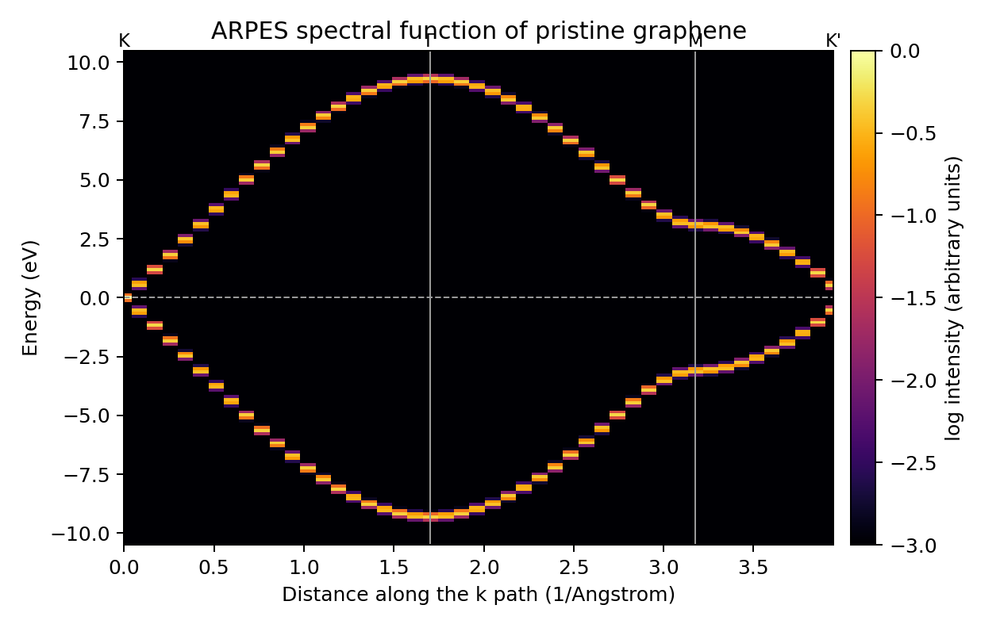
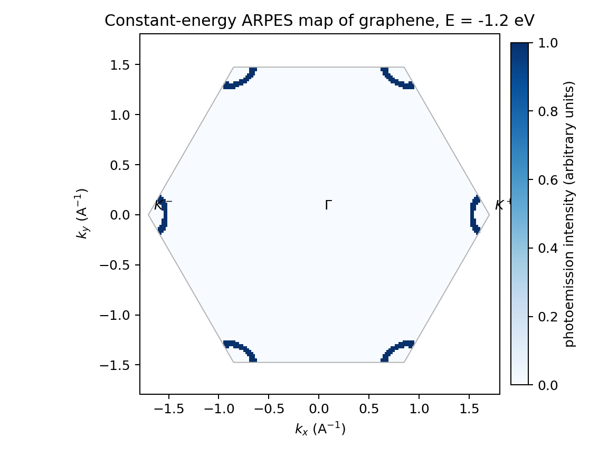
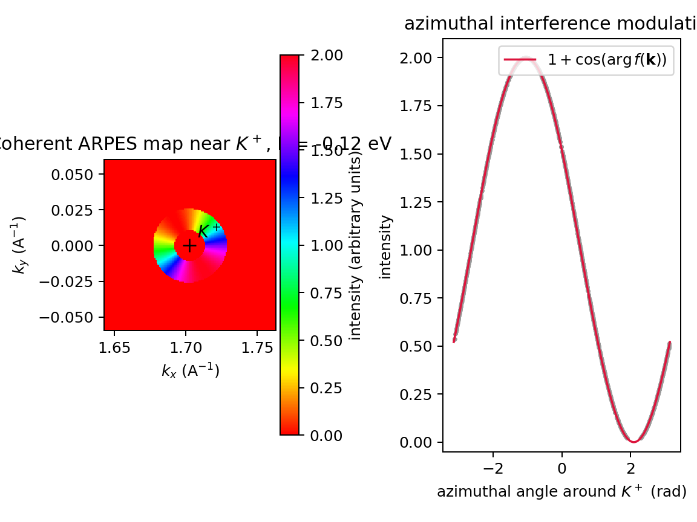
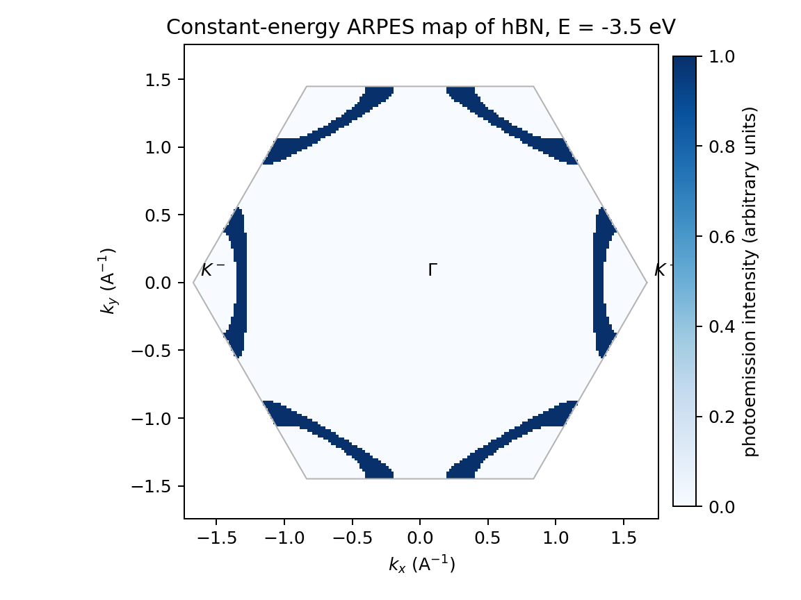

# ARPES intensity examples (10–13)

Photoemission intensity from the spectral function. Inputs and scripts:
[10](https://github.com/gjung-group/grabnes/tree/main/examples/10_graphene_arpes_intensity),
[11](https://github.com/gjung-group/grabnes/tree/main/examples/11_hbn_arpes_intensity).

(ex-10)=
## 10: Pristine graphene ARPES intensity

The photoemission intensity `I(k,E)` of one graphene sheet, computed with the
spectral function on a k grid instead of the density of states, in the two
pictures an ARPES experiment is read in. Each picture is a separate folder
with its own `Gendata.in`, `run.sh` and `plot.py`:

| Folder | Picture |
| --- | --- |
| `spectral_function_path/` | Intensity `I(k,E)` along the `K-Gamma-M-K'` line, as in example 01: Dirac cone at `K`, van Hove singularities at `+-g0`, `sigma` bands near `+-9.3 eV` at `Gamma`. |
| `constant_energy_map/` | Intensity `I(kx,ky)` at one energy over the whole first Brillouin zone, Fig. 8(b) of Zhu, Shi and MacDonald, arXiv:2006.08908: the warped hexagonal contour around the six `K` points. |

Both use the same physics: nearest-neighbor graphene with `TB.Hopping 3.1`
and the photoemission matrix element of Wei and Ku,
Phys. Rev. B 95, 085420 (2017). Both runs take about a second.







```sh
cd spectral_function_path       # or constant_energy_map
./run.sh                        # or GRABNES_BIN=/path/to/grabnes ./run.sh
python3 plot.py                 # figure in reference/
```

Download: [`Gendata.in` (path)](../assets/downloads/examples/10_graphene_arpes_intensity/spectral_function_path/Gendata.in)
· [`Gendata.in` (map)](../assets/downloads/examples/10_graphene_arpes_intensity/constant_energy_map/Gendata.in)
· [`Gendata.in` (coherent map)](../assets/downloads/examples/10_graphene_arpes_intensity/coherent_map_nishi/Gendata.in)

```{note}
A third folder, `coherent_map_nishi/`, computes a coherent (Nishi-mode) map
near K+; see the
[example folder](https://github.com/gjung-group/grabnes/tree/main/examples/10_graphene_arpes_intensity)
for its description.
```

(ex-11)=
## 11: hBN ARPES intensity

The photoemission intensity of one hBN sheet. Like example 10, this example
is organized in one folder per picture:

| Folder | Picture | Status |
| --- | --- | --- |
| `constant_energy_map/` | Intensity `I(kx,ky)` at `E = -3.5 eV` over the whole first Brillouin zone: the six warped hole pockets around the `K` points of the gapped `pi` bands. | Ready |
| `spectral_function_path/` | Intensity `I(k,E)` along a line of the Brillouin zone. | Work in progress |



Both pictures need the photoemission weights of `Spectral.WeiKu`, which are
implemented for the two sublattices `Species 1` and 2 only. `Run.TypeOfSystem
BoronNitride` labels its atoms `Species 3` and 4, so it yields zero intensity
everywhere; `constant_energy_map/` therefore models hBN as a honeycomb of two
sublattices split by `Potential.SublatticeMassterm`, which is the same
Hamiltonian. The spectral function along a path could use the same model,
but has not been written up yet.

```sh
cd constant_energy_map
./run.sh                        # or GRABNES_BIN=/path/to/grabnes ./run.sh
python3 plot.py                 # figure in reference/
```

Download: [`Gendata.in`](../assets/downloads/examples/11_hbn_arpes_intensity/constant_energy_map/Gendata.in)
· [`run.sh`](../assets/downloads/examples/11_hbn_arpes_intensity/constant_energy_map/run.sh)
· [`plot.py`](../assets/downloads/examples/11_hbn_arpes_intensity/constant_energy_map/plot.py)

(ex-12)=
## 12: Graphene on hBN ARPES intensity

```{admonition} Work in progress
The spectral function `I(k,E)` of graphene on hBN. This example is reserved
in the code repository and not yet documented.
```

(ex-13)=
## 13: Twisted bilayer ARPES intensity

```{admonition} Work in progress
The spectral function `I(k,E)` of twisted bilayer graphene. This example is
reserved in the code repository and not yet documented.
```
