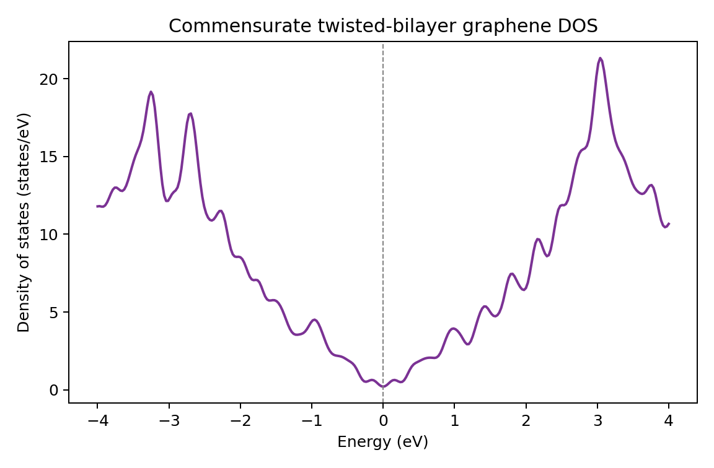

# Getting-started examples (01–04)

Installation checks by exact diagonalization; each runs in a few seconds on
one core. Inputs and scripts:
[01](https://github.com/gjung-group/grabnes/tree/main/examples/01_graphene_bands),
[02](https://github.com/gjung-group/grabnes/tree/main/examples/02_graphene_dos),
[03](https://github.com/gjung-group/grabnes/tree/main/examples/03_twisted_bilayer_bands),
[04](https://github.com/gjung-group/grabnes/tree/main/examples/04_twisted_bilayer_dos).

(ex-01)=
## 01: Pristine graphene bands

This is the smallest GRABNES band-structure calculation. It constructs a
two-atom pristine graphene cell and evaluates its two pi bands along the
`K - Gamma - M - K'` path.


```sh
./run.sh
python3 plot.py
```

The plotting step requires Python 3 and Matplotlib. `run.sh` writes the
program log to `job.out` and GRABNES writes the band data to
`generate.bands`. `plot.py` creates `graphene_bands.png`; if a calculation has
not been run yet, it uses the reference data, so the expected result can still
be inspected.

**Important input controls**

- `TB.Hopping` sets the nearest-neighbor hopping in electronvolts.
- `Bands.NumPoints` controls the sampling density along each path segment.
- `Bands.Path` lists the high-symmetry points in reciprocal coordinates.
- `Prefix` determines the prefix of generated output files.

The reference data were generated by the pristine-band example used in the
Twistronics 2023 tutorial — see also {doc}`../tutorials/graphene`.

Download: [`Gendata.in`](../assets/downloads/examples/01_graphene_bands/Gendata.in)
· [`run.sh`](../assets/downloads/examples/01_graphene_bands/run.sh)
· [`plot.py`](../assets/downloads/examples/01_graphene_bands/plot.py)

(ex-02)=
## 02: Pristine graphene density of states

This example computes the graphene density of states by diagonalizing the
two-band Bloch Hamiltonian on a `30 x 30` k-point grid and applying Gaussian
broadening. It is deterministic and intended as a quick installation check.


```sh
./run.sh
python3 plot.py
```

The calculation writes `generate.diag.DOS` and `job.out`; the plotting step
writes `graphene_dos.png`.

Important controls are `KGrid`, `NumberofEnergyPoints`, `Epsilon`,
`DOS.Emin`, and `DOS.Emax`. Denser k-point or energy grids improve the curve
but take longer.

Download: [`Gendata.in`](../assets/downloads/examples/02_graphene_dos/Gendata.in)
· [`run.sh`](../assets/downloads/examples/02_graphene_dos/run.sh)
· [`plot.py`](../assets/downloads/examples/02_graphene_dos/plot.py)

(ex-03)=
## 03: Twisted-bilayer graphene bands

This example constructs the `(m,n) = (3,2)` commensurate twisted-bilayer
graphene cell (76 atoms, approximately 13.17 degrees) and evaluates its bands
along `K - Gamma - M - K'` with the Koshino interlayer hopping model.


**What the reference data represent.** This example is a regression test of
one specific Hamiltonian; it is not independent evidence that this Hamiltonian
is the best description of twisted bilayer graphene.

- Intralayer: nearest-neighbor hopping only (`TB.NeighLevels 1`), -2.9888 eV,
  the default `TB.Hopping` for a lattice parameter of 2.46 A.
- Interlayer: two-center form of Moon and Koshino, Phys. Rev. B 85, 195458
  (2012), with `vppsigma0` = 0.48 eV, decay length 0.184 a, interlayer
  distance 3.34 A, for pairs up to 9.69 A apart in the plane. `vpppi0`, which
  here only scales the pi part of the interlayer hopping, has its default of
  3.5 eV, the value that goes with the F2G2-type intralayer models this
  example belongs to. The original Koshino model is a different choice:
  `KoshinoIntralayer .true.`, whose default `vpppi0` is the Moon-Koshino value
  of 2.7 eV. This example demonstrates neither velocity; its Dirac velocity is
  set by `TB.Hopping`.

`TB.NeighLevels` is the number of intralayer neighbor shells. With
`TB.NeighLevels 5` GRABNES uses its F2G2 intralayer model, which moves the
Dirac point to about -0.33 eV and the band edges by more than 2 eV; it is
checked against an independent implementation but has no reference data here.

The reference data were regenerated in October 2026 after the neighbor search
was corrected (changes up to 1e-4 eV). The solver reproduces an independently
built Hamiltonian for this example to 4e-16 eV per matrix element.

Download: [`Gendata.in`](../assets/downloads/examples/03_twisted_bilayer_bands/Gendata.in)
· [`run.sh`](../assets/downloads/examples/03_twisted_bilayer_bands/run.sh)
· [`plot.py`](../assets/downloads/examples/03_twisted_bilayer_bands/plot.py)

(ex-04)=
## 04: Twisted-bilayer graphene density of states

This example uses exact diagonalization on an `8 x 8` k-point grid to compute
the density of states of the same 76-atom `(m,n) = (3,2)` commensurate cell as
example 03. Gaussian broadening produces a compact, deterministic laptop test.
The Hamiltonian is the one of example 03 (nearest-neighbor intralayer hopping,
two-center interlayer hopping); see its description above for what the
reference data represent. They were regenerated together with those of
example 03.



```sh
./run.sh
python3 plot.py
```

The calculation writes `generate.diag.DOS` and `job.out`; the plotting step
writes `twisted_bilayer_dos.png`.

For a smoother production DOS, increase `KGrid` and
`NumberofEnergyPoints`, and reduce `Epsilon` after checking convergence.

Download: [`Gendata.in`](../assets/downloads/examples/04_twisted_bilayer_dos/Gendata.in)
· [`run.sh`](../assets/downloads/examples/04_twisted_bilayer_dos/run.sh)
· [`plot.py`](../assets/downloads/examples/04_twisted_bilayer_dos/plot.py)
