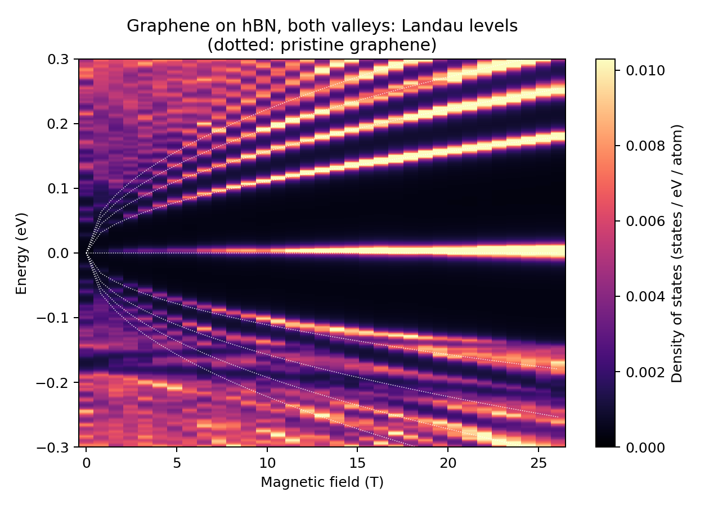
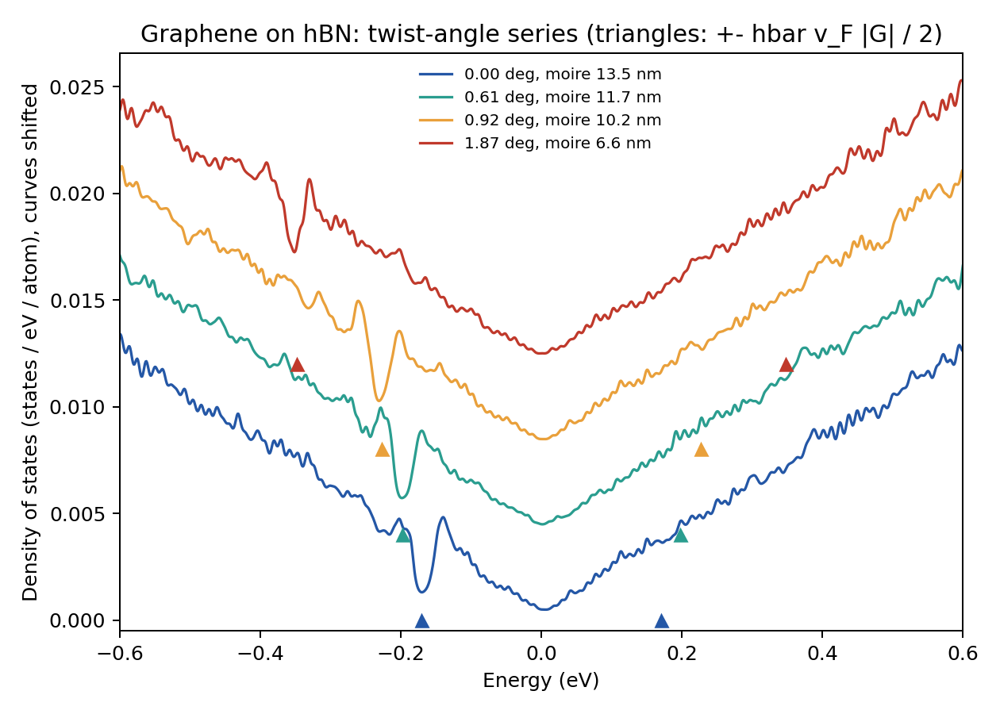
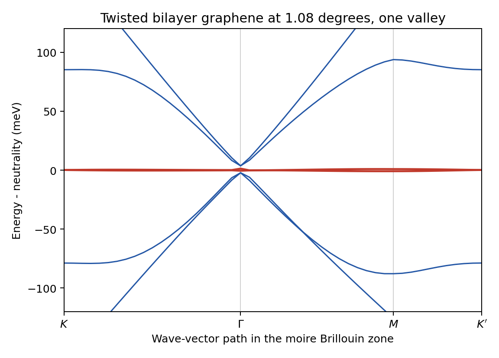
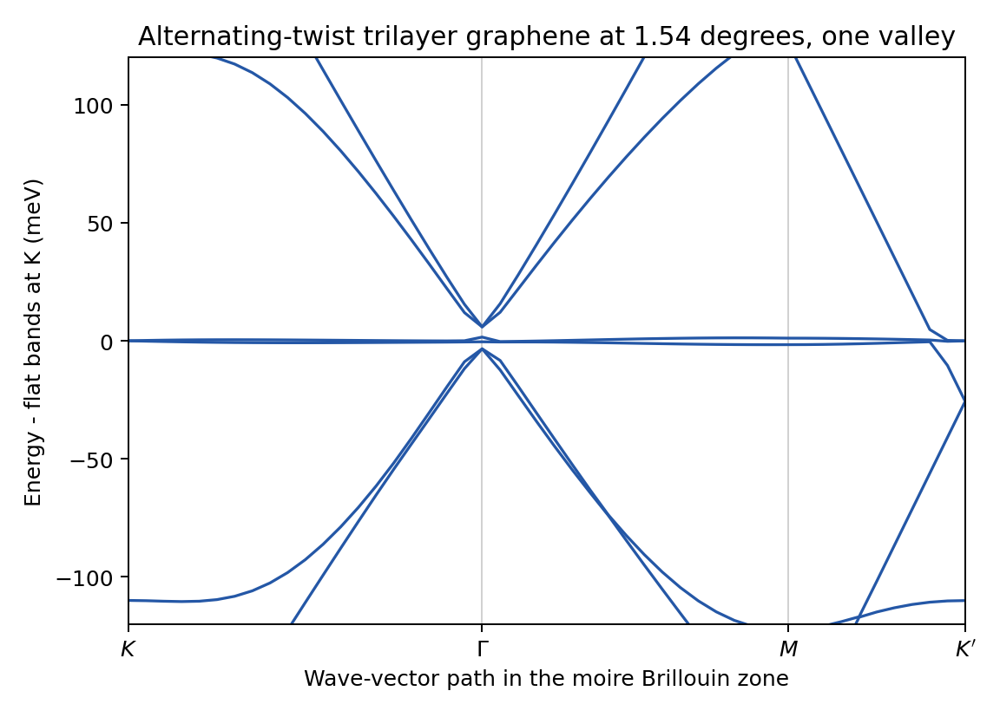

# Moiré examples (05–09)

Larger examples on rigid lattices; they take from 20 seconds to 5 minutes on
4 cores. Inputs and scripts:
[05](https://github.com/gjung-group/grabnes/tree/main/examples/05_graphene_hbn_bands),
[06](https://github.com/gjung-group/grabnes/tree/main/examples/06_graphene_hbn_landau_levels),
[07](https://github.com/gjung-group/grabnes/tree/main/examples/07_graphene_hbn_twist_series),
[08](https://github.com/gjung-group/grabnes/tree/main/examples/08_magic_angle_twisted_bilayer),
[09](https://github.com/gjung-group/grabnes/tree/main/examples/09_alternating_twist_trilayer).

(ex-05)=
## 05: Aligned graphene on hBN, moiré bands

Graphene on hexagonal boron nitride at zero twist, described by the effective
moire model of Jung, Raoux, Qiao and MacDonald, Phys. Rev. B 89, 205414
(2014): the hBN layer is not simulated; its effect on the graphene electrons
is a potential with the period of the moire pattern, added to the
nearest-neighbor tight-binding model of graphene. The example computes the
bands of one valley along `Gamma - K - M - Gamma` of the moire Brillouin zone.

### The cell

`Structure.CellSize 55` builds 55 x 55 graphene cells (6050 atoms), one moire
cell of 13.5 nm for a lattice mismatch of -1/55 (`Moire.LatticePercent`). The
mismatch enters the moire potential only; the cell must hold a whole number of
moire periods, which is why the two numbers go together.

### The model

- Graphene: nearest-neighbor hopping, 2.9887 eV (the default `TB.Hopping` for
  a lattice constant of 2.46 A).
- Moire terms (`Moire.Jeil`, `Moire.H0AndHZ`, `Moire.OffDiag`): a scalar
  potential, a sublattice-staggered potential and a modulation of the
  hopping, each a first-harmonic function with the amplitudes and phases of
  the paper (`Moire.PotC0`, `PotCz`, `PotCab` in eV; `PotPhi0`, `PotPhiz`,
  `PotPhiab` in radians).
- `Moire.OffDiagMidpoint .true.` evaluates the hopping modulation at the
  middle of each bond, which makes the Hamiltonian Hermitian. Without it the
  term is evaluated at the first atom of the bond, the two directions of a
  bond differ slightly (the solver prints by how much), and the bands differ
  by about 0.1 meV.

### The plane-wave reduction

A direct diagonalization of 6050 atoms per k-point is slow. With `TAPW.Use`
the Hamiltonian is projected on plane waves around one graphene valley
(`Diag.N_G 8`: 55 moire reciprocal vectors, two sublattices, 110 states), and
the 110 x 110 matrix is diagonalized. This gives the bands of ONE valley; the
other valley (`Diag.UseKprimeValley .true.`) is its mirror image in k.

The reduction was compared with the direct diagonalization of the same
Hamiltonian in both directions (October 2026): at seven k-points, the levels
of the two valleys together are the exact levels within 0.3 eV of neutrality,
78 of 78, with differences below 0.001 meV.

Run the reduction with one OpenMP thread (`run.sh` sets `OMP_NUM_THREADS=1`).

### What to look for

- The graphene Dirac point folds to a corner of the moire zone. For this
  valley it is the corner (1/3, 2/3) in units of the reciprocal vectors of
  the cell, labelled `K` in the figure; the other valley has it at (2/3, 1/3).
- A gap of 1.7 meV at the Dirac point.
- On the hole side, a gap of 48 meV along this path between the first and the
  second band (at -0.15 and -0.20 eV); on the electron side the corresponding
  gap is only 2 meV (at 0.196 eV). This asymmetry is the known signature of
  the model.

The numbers above are those of this model and these parameters. A relaxed
atomic structure changes them (the gap at the Dirac point in particular).

The calculation takes about 20 seconds.

Download: [`Gendata.in`](../assets/downloads/examples/05_graphene_hbn_bands/Gendata.in)
· [`run.sh`](../assets/downloads/examples/05_graphene_hbn_bands/run.sh)
· [`plot.py`](../assets/downloads/examples/05_graphene_hbn_bands/plot.py)

(ex-06)=
## 06: Aligned graphene on hBN, Landau levels against magnetic field

The density of states of the system of example 05 in a perpendicular magnetic
field, for 33 fields from 0 to 26 T: the Landau-level fan of the Dirac point,
the second fan that starts from the secondary Dirac point on the hole side,
and the beginning of the Hofstadter pattern where the two meet.

The map contains **both valleys**: it is computed on the full tight-binding
Hamiltonian in real space, without the one-valley plane-wave reduction of
example 05. In a field the two valleys of this system have different levels
(hBN breaks inversion symmetry), and the map is their sum, per atom and for
one spin.

### Method

- **Cell.** 8 x 8 moire cells (`Structure.SuperCell 8`), 387 200 atoms. The
  model is the one of example 05.
- **Magnetic field.** A Peierls phase on every hopping, in a gauge that is
  periodic in the supercell. This is possible only when a whole number m of
  flux quanta passes through the supercell, so the fields are
  B = m x 0.4076 T (`MagField.InitialInteger`, `FinalInteger`, `IntegerStep`;
  m = 0, 2, ..., 64). m = 64 is one flux quantum per moire cell, 26.09 T.
  These three keys make the run a sweep: one calculation per field, each
  written to its own directory `m<m>_B<field>/`. For a single field use
  `MagField.Integer m` instead.
- **Density of states.** The recursion (Lanczos) method with one random
  vector: 3000 steps, a broadening of 4 meV (`Kubo.Epsilon`, in eV), 601
  energies between -0.3 and 0.3 eV. Nothing is diagonalized, so the cost
  grows linearly with the number of atoms.

`Moire.OffDiagMidpoint .true.` is required here: the recursion method needs a
Hermitian Hamiltonian.

### What limits the resolution

- The broadening must be supported by the number of recursion steps: steps
  needed ~ (width of the whole spectrum, 18 eV) / broadening. 3000 steps and
  4 meV are a compromise for a short run; halving the broadening needs twice
  the steps.
- At a field of m flux quanta every level of the supercell is degenerate, and
  a chain of N steps is meaningful only while N is well below
  (number of atoms) x gcd(m, 64) / 64. With even m this bound is at least
  12 100, four times the chain used here. Odd m would halve it.
- A larger supercell gives a finer field step (B = m x 26.09 T / SuperCell^2)
  and less noise.

### What to look for

- Levels that follow $E_N = \mathrm{sgn}(N)\, v_F \sqrt{2 e \hbar B |N|}$ of
  pristine graphene at low field (dotted lines in the figure; $v_F$ is that of
  the nearest-neighbor model, $\hbar v_F = 6.37$ eV A), with a level that
  stays at the Dirac point.
- On the hole side the levels are not those of pristine graphene: they bend,
  split and cross between -0.15 and -0.25 eV, the energy of the secondary
  Dirac point of the moire bands (example 05). The electron side stays close
  to the pristine fan, in line with the weak moire features there.
- Below about 4 T the levels are closer than the broadening and the map shows
  the discrete levels of the supercell instead.

With four threads the 33 fields take about four minutes and 250 MB of memory.

Download: [`Gendata.in`](../assets/downloads/examples/06_graphene_hbn_landau_levels/Gendata.in)
· [`run.sh`](../assets/downloads/examples/06_graphene_hbn_landau_levels/run.sh)
· [`plot.py`](../assets/downloads/examples/06_graphene_hbn_landau_levels/plot.py)

(ex-07)=
## 07: Graphene on hBN, a series of twist angles

The density of states of graphene on hBN for four twist angles between the
two crystals, 0, 0.61, 0.92 and 1.87 degrees, with the effective moire model
of examples 05 and 06. The moire period shrinks from 13.5 nm to 6.6 nm, and
the dip that the moire potential makes in the density of states on the hole
side moves away from the Dirac point accordingly.

### Commensurate cells

The effective model adds a moire potential to a graphene cell, so the moire
pattern must be periodic in that cell. For N x N graphene cells this holds
when the hBN lattice vector satisfies `N b1 = p a1 + q a2` with integers p
and q, which fixes the lattice mismatch (`Moire.LatticePercent`) and the twist
angle (`Moire.TwistAngle`, in degrees, with `Moire.Twisted .true.`):

| Input | N | (p, q) | mismatch | twist | moire period | SuperCell | atoms |
| --- | --- | --- | --- | --- | --- | --- | --- |
| `Gendata_0.00.in` | 55 | (54, 0) | -1.818 % | 0 | 13.53 nm | 24 | 3 484 800 |
| `Gendata_0.61.in` | 83 | (81, 1) | -1.802 % | 0.609 deg | 11.79 nm | 16 | 3 527 168 |
| `Gendata_0.92.in` | 110 | (107, 2) | -1.806 % | 0.919 deg | 10.23 nm | 12 | 3 484 800 |
| `Gendata_1.87.in` | 27 | (26, 1) | -1.799 % | 1.872 deg | 6.64 nm | 48 | 3 359 232 |

`make_inputs.py` computes these numbers and writes the four inputs from
`Gendata.template`; edit its table to add angles. The two keys must be given
with all their digits: a rounded value makes the potential discontinuous at
the cell boundary.

### Method

The recursion (Lanczos) method of example 06 at zero field: 3000 steps, a
broadening of 5 meV, one random vector. Without a magnetic field the spectrum
is continuous, and a smooth density of states from one random vector needs a
large system: `Structure.SuperCell` repeats each cell to about 3.5 million
atoms. With a tenth of that, the curve is dominated by the discrete levels of
the supercell.

### What to look for

- A dip on the hole side at -0.17 eV for zero twist, moving to -0.20, -0.23
  and -0.35 eV as the twist grows.
- The triangles in the figure mark the energy at which the Dirac cone of
  pristine graphene reaches the edge of the moire Brillouin zone,
  hbar v_F |G| / 2 with |G| = 4 pi / (sqrt(3) L) for a moire period L. The
  dips follow them.
- On the electron side the feature is much weaker, as in example 05.

With four threads the four runs take about five minutes and 1.5 GB of memory.

Download: [`Gendata_0.00.in`](../assets/downloads/examples/07_graphene_hbn_twist_series/Gendata_0.00.in)
· [`Gendata_0.61.in`](../assets/downloads/examples/07_graphene_hbn_twist_series/Gendata_0.61.in)
· [`Gendata_0.92.in`](../assets/downloads/examples/07_graphene_hbn_twist_series/Gendata_0.92.in)
· [`Gendata_1.87.in`](../assets/downloads/examples/07_graphene_hbn_twist_series/Gendata_1.87.in)
· [`make_inputs.py`](../assets/downloads/examples/07_graphene_hbn_twist_series/make_inputs.py)

(ex-08)=
## 08: Twisted bilayer graphene near the magic angle

Twisted bilayer graphene at 1.08 degrees: the commensurate cell
`(m, n) = (31, 30)` with 11 164 atoms, built by the solver, and the bands of
one valley along `K - Gamma - M - K'` of the moire Brillouin zone. The two
bands at charge neutrality are flat: they span 2.2 meV along the path.

### The model

- Intralayer: the F2G2 model of graphene with five neighbor shells
  (`Intralayer.F2G2Model`, `TB.NeighLevels 5`), with the first-neighbor
  hopping set to 3.5 eV and the site energy to 0.4914 eV (`TB.Hopping`,
  `TB.OnSiteC`). The site energy only sets the zero of energy: neutrality
  lies at 0.178 eV.
- Interlayer: the two-center form with a decay that depends on the distance
  (`Interlayer.TypeOfBL Koshino`, `Interlayer.KoshinoSR`), multiplied by one
  factor (`Interlayer.RenormalizeCoupling`, `Interlayer.CouplingFactor`).
- The structure is rigid: flat layers 3.35 A apart, no lattice relaxation.
  The factor 1.008 puts the flattest bands of the RIGID lattice near 1.08
  degrees. With relaxed structures the same model is used with 0.895.

This is the model family of Leconte, Javvaji, An, Samudrala and Jung, Phys.
Rev. B 106, 115410 (2022), run here on a rigid lattice. Lattice relaxation
changes the result qualitatively in one respect: it opens gaps between the
flat bands and the bands above and below. In this rigid calculation those
bands come within 3 meV of the flat bands at `Gamma`.

### The plane-wave reduction

As in example 05, the Hamiltonian is projected on plane waves around one
graphene valley (`Diag.N_G 8`: 55 moire reciprocal vectors, two layers, two
sublattices, 220 states). `Diag.MoireAngle 0.0` is the orientation of the
first layer in the frame of the cell that the solver builds.

Compared with the direct diagonalization of the same 11 164-atom Hamiltonian
in both directions (October 2026): at six k-points the levels of the two
valleys together are the exact levels within 0.3 eV of neutrality, 171 of
171; differences up to 0.02 meV within 50 meV and 0.18 meV within 0.3 eV.

The calculation takes about two minutes; the plotting step prints the width
of the flat bands.

Download: [`Gendata.in`](../assets/downloads/examples/08_magic_angle_twisted_bilayer/Gendata.in)
· [`run.sh`](../assets/downloads/examples/08_magic_angle_twisted_bilayer/run.sh)
· [`plot.py`](../assets/downloads/examples/08_magic_angle_twisted_bilayer/plot.py)

(ex-09)=
## 09: Alternating-twist trilayer graphene, structure read from files

Three graphene layers in which the middle one is twisted by 1.54 degrees
against the two outer ones (8322 atoms). The structure is not built by the
solver: it is read from files (`Run.TypeOfSystem ReadXYZ`), which is how a
relaxed structure from a molecular-dynamics code is used. Here a small script
writes a rigid structure, so the example needs no other program.

### The structure files

`make_structure.py` writes, for the commensurate cell `(m, n) = (22, 21)`:

| File | Content |
| --- | --- |
| `generate.xyz` | three lines with the cell vectors [A], the number of atoms, then `element x y z` per atom |
| `layerIndex.dat` | the layer of every atom (1 = bottom), read with `Structure.ReadLayerIndex .true.` |
| `sublatticesSorted.dat` | atom number and sublattice (1 or 2) |

The atoms keep the order of the file. `python3 make_structure.py m n` writes
another commensurate cell; `run.sh` calls the script when the files are
missing.

### The model

The model of example 08 (F2G2 intralayer, two-center interlayer with factor
1.008 on a rigid lattice), with `Stack.ThreeLayers` and `Stack.MiddleTwist`:
single-layer intralayer parameters in every layer. The twist is sqrt(2)
times the angle of example 08, the relation between the flat-band angles of
the trilayer and of the bilayer.

This is the model family of Leconte, Park, An, Samudrala and Jung, 2D Mater.
9, 044002 (2022), run here on a rigid lattice.

### What to look for

- Two flat bands at 0.191 eV, 3 meV wide along the path, as in the bilayer.
- In addition the Dirac cone of a single graphene layer, which the trilayer
  keeps because of its mirror symmetry. For this valley it sits at the corner
  `K'` = (1/3, 2/3) of the moire zone; the path ends there.
- In this rigid model the Dirac point lies 26 meV BELOW the flat bands, at
  0.165 eV, the Dirac energy of the single-layer parameters. The offset is a
  property of this parameter set on a rigid lattice, not a general statement
  about the material.

### The plane-wave reduction

`Diag.N_G 8` gives 330 states (55 moire reciprocal vectors, three layers, two
sublattices). `Diag.MoireAngle 0.0` because the first layer of the file has
its lattice vector along x and the cell is not rotated; a structure whose
cell was rotated needs the angle of that rotation.

Compared with the direct diagonalization of the same Hamiltonian in both
directions (October 2026): at six k-points, 135 of 135 levels within 0.3 eV;
differences up to 0.02 meV within 50 meV and 0.11 meV within 0.3 eV.

The calculation takes about three minutes.

Download: [`Gendata.in`](../assets/downloads/examples/09_alternating_twist_trilayer/Gendata.in)
· [`make_structure.py`](../assets/downloads/examples/09_alternating_twist_trilayer/make_structure.py)
· [`run.sh`](../assets/downloads/examples/09_alternating_twist_trilayer/run.sh)
· [`plot.py`](../assets/downloads/examples/09_alternating_twist_trilayer/plot.py)
