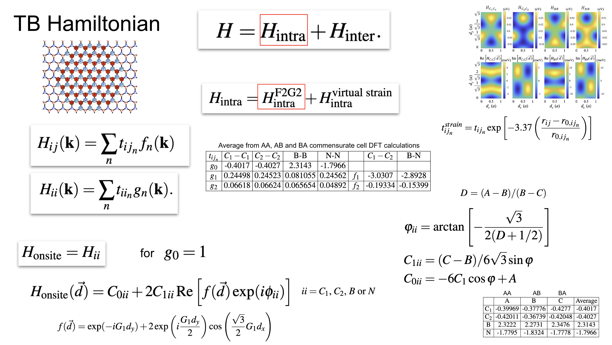
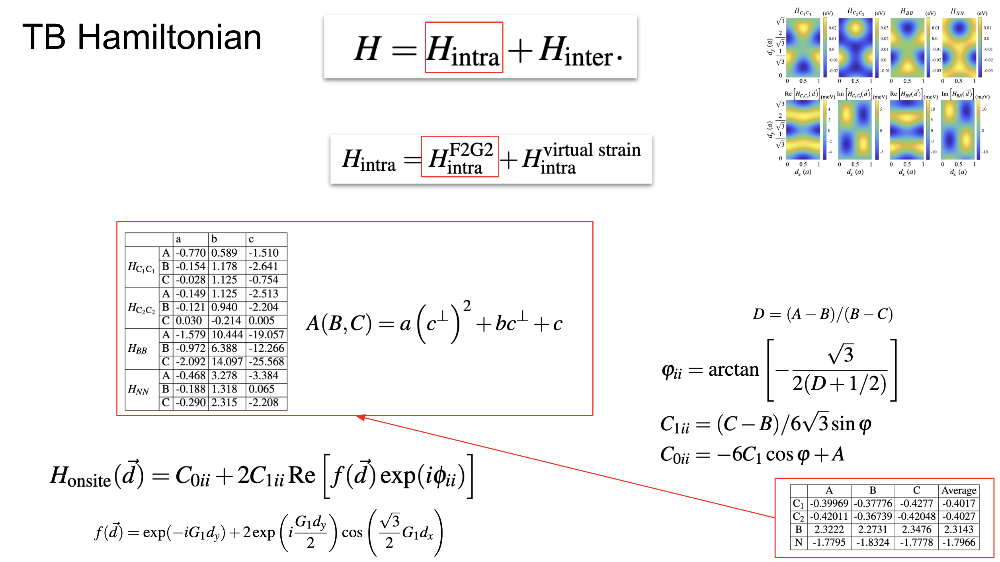
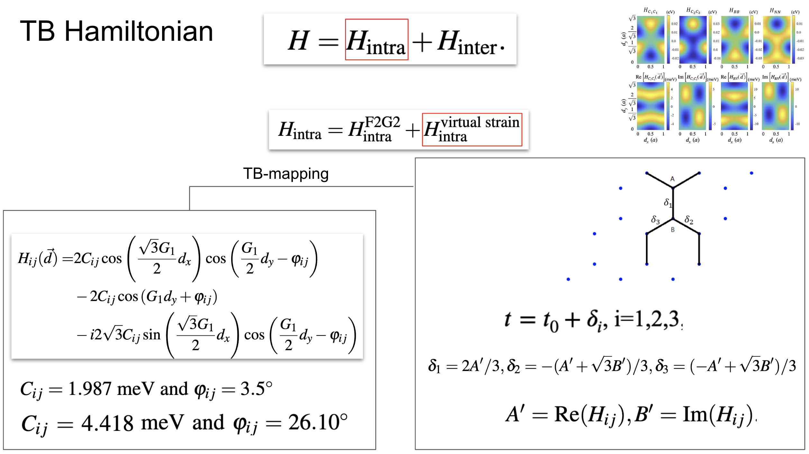
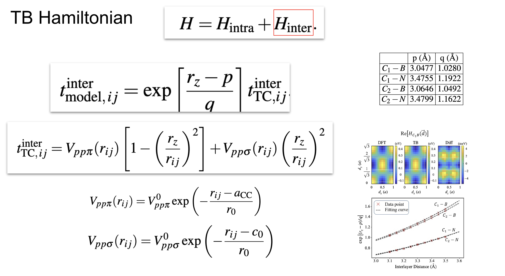
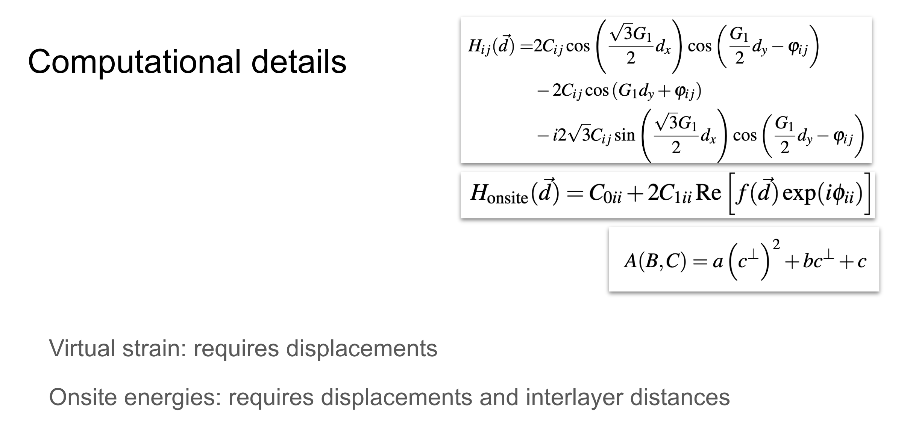

# Tight-binding models

GRABNES is a real-space tight-binding code. The models implemented in the
package combine an accurate intralayer parametrization with a
distance-dependent interlayer parametrization matched to DFT. This page
summarizes the models; the corresponding input flags are documented in the
{doc}`../tutorials/input-reference`.

## F2G2: intralayer model from maximally localized Wannier functions

Accurate graphene band structures are obtained with the F2G2 model proposed
in
[_Tight-binding model for graphene $\pi$-bands from maximally localized Wannier functions_](https://journals.aps.org/prb/abstract/10.1103/PhysRevB.87.195450).
The model requires including up to 5th nearest neighbors
(`TB.NeighLevels 5`). The current parametrization has been optimized to
capture the low-energy states of DFT calculations while limiting the range of
the model. Two of its parameters are exposed as input flags:

- `TB.OnSiteC 0.4914` — the carbon onsite energy,
- `TB.Hopping 3.07504` — the first nearest-neighbor hopping.

Including only the first nearest-neighbor hopping (`TB.NeighLevels 1`)
recovers the particle–hole symmetric nearest-neighbor bands; the longer-range
terms capture the electron–hole asymmetry neglected at that level.

## Two-center (TC) model for interlayer coupling

The interlayer interactions are described by a two-center approximation model
introduced in
[_Phys. Rev. B 86, 125413_](https://journals.aps.org/prb/abstract/10.1103/PhysRevB.86.125413):

$$
    t_{ {\rm TC}, \, ij} = V_{pp\pi}(r_{ij}) \left[1 - \left(\frac{ c_{ij} }{r_{ij}} \right)^2 \right] + V_{pp\sigma}(r_{ij}) \left(\frac{ c_{ij} }{r_{ij}} \right)^2
$$

where

$$
    V_{pp\pi}(r_{ij}) = V_{pp\pi}^0 \exp\left(-\frac{r_{ij}-a_{\rm CC}}{r_0}\right)
$$

and

$$
    V_{pp\sigma}(r_{ij}) = V_{pp\sigma}^0 \exp\left(-\frac{r_{ij}-c_0}{r_0}\right),
$$

where $r_{ij} = \left| \textbf{r}_{ij} \right|$ is the magnitude of the
interatomic distance and $c_{ij} = \textbf{r}_{ij} \cdot \textbf{e}_z$ is the
vertical axis projection along the $z$-axis normal to the graphene plane. For
simplicity, a fixed normal vector $\textbf{e}_z$ is defined along the $z$-axis
rather than allowing it to tilt with the local curvature following the surface
corrugation. The parameters are:

| Parameter | Value | Meaning |
|---|---|---|
| $c_0$ | 3.35 Å | interlayer distance |
| $a_{\rm CC}$ | 1.42 Å | rigid graphene interatomic carbon distance |
| $V_{pp\pi}^0$ | $-2.7$ eV | transfer integral between nearest-neighbor atoms |
| $V_{pp\sigma}^0$ | 0.48 eV | transfer integral between two vertically aligned atoms, fitted to GGA data at fixed interlayer distance |
| $r_0$ | $0.184\,a$ | decay length, chosen so the next-nearest intralayer coupling is $0.1\,V_{pp\sigma}^0$ |

The cutoff for this distance-dependent model is set to 4.9 Å, beyond which
additional contributions do not affect the observables anymore.

## Hybrid F2G2–TC models

Hybrid models leverage the precision of the accurate F2G2 model for the
intralayer interactions and the reparametrized two-center (TC) models that
match as closely as possible with DFT for the interlayer interactions. In the
input file they are selected with `TypeOfSL HTC` (single-layer reference) or
`TypeOfBL HTC` (bilayer reference). The following slides illustrate the
general approach for the graphene-on-hBN two-layer hybrid model:

---

---

---

---

## SHE model: magic-angle renormalized coupling

For twisted bilayer graphene the code implements the SHE model introduced in
[_Phys. Rev. B 106, 115410_](https://journals.aps.org/prb/abstract/10.1103/PhysRevB.106.115410),
where the intralayer F2G2 model is the same as for single-layer graphene and
the interlayer terms are given by a reparametrized and magic-angle
renormalized two-center TC approximation:

$$
t_{{\rm SHE}, \, ij} =
\begin{cases}
t^{{\rm intra}}_{{\rm F2G2}, \, ij}
& \mbox{if }   i \in \mbox{ layer} j \\
S \, \exp\left[ {(c_{ij} - p)}/{q} \right] \, t^{{\rm inter}}_{{\rm TC}, \, ij} & \mbox{if }  i \notin  \mbox{ layer} j
\end{cases}
$$

where $p = 3.25$ Å and $q = 1.34$ Å capture the interlayer dependence of the
DFT parametrization, and $S$ is a relaxation-dependent renormalization factor
which anchors the magic angle at a chosen value ($S = 0.895$ for structures
relaxed with the EXX-RPA-fitted force field, $S = 1.008$ for rigid structures
at 3.35 Å interlayer distance). In the input file this is activated with
`KoshinoSR .true.` combined with `renormalizeCoupling .true.` and
`couplingFactor <S>`.

Because the interlayer coupling can be renormalized by the $S$ factor, one
can obtain by construction a flat band at a larger twist angle that requires
a much smaller commensurate cell. The effective angle is estimated as

\begin{equation}
\theta_\text{eff} = S \theta_\text{ref}/S^\prime
\end{equation}

where $\theta_\text{ref}$ is the angle of the commensurate cell. Note that
the larger the difference between the effective angle and the reference
angle, the less accurate this approach becomes, especially for relaxed
systems where the relaxation strength is angle-dependent. Under normal
conditions one would use reference angles very close to the effective angle.

## Effective moiré model for graphene on hBN

For graphene on hBN the code implements the
[effective model extracted from DFT calculations](https://journals.aps.org/prb/abstract/10.1103/PhysRevB.89.205414)
which is accurate close to the K-point. It collapses the effect of the hBN
layer into periodic corrections to the onsite energies and hopping terms of a
reference graphene layer, reducing the computational cost by a factor of two.
The Hamiltonian is

$$
H_\text{eff}(\textbf{r})=H_{0}(\textbf{r})+H_{z}(\textbf{r})+H_{xy}(\textbf{r})
$$

based on the local stacking function
$\textbf{d}(\textbf{r}) = (\alpha \mathcal{R}(\theta)-1)\textbf{r}$, where
$\alpha = a_G/a_{BN} = 1+\epsilon$ with the lattice constants of graphene
(numerator) and hBN (denominator), and $\mathcal{R}(\theta)$ is the rotation
operator acting on an atom at lattice site $\textbf{r}$. The graphene layer
Hamiltonian terms acquire the periodic corrections

$$
H_{0}(\textbf{r}) = 2C_0 \Re e[f(\textbf{r})\exp(i\phi_{0})],
$$

$$
H_{z}(\textbf{r}) = 2C_z \Re e[f(\textbf{r})\exp(i\phi_{z})]
$$

with

$$
f(\textbf{r}) = \sum_m \exp(i \textbf{G}_m \cdot \textbf{d}(\textbf{r}))(1+(-1)^m)/2
$$

where $\textbf{G}_m$ are the reciprocal lattice vectors, and

$$
H_{AB}(\textbf{r}) = H_{xy}^\ast(\textbf{r})
$$

where

$$
H_{xy}(\textbf{r}) = 2 C_{xy} \cos(\phi) (\textbf{z}) \times \nabla \Re e \left[ e^{i\phi_{xy}} f(\textbf{r})\right].
$$

The rigid-configuration parametrization used in the tutorials is applied with
the `MoirePot*` flags listed in {doc}`../tutorials/graphene-on-hbn`.
