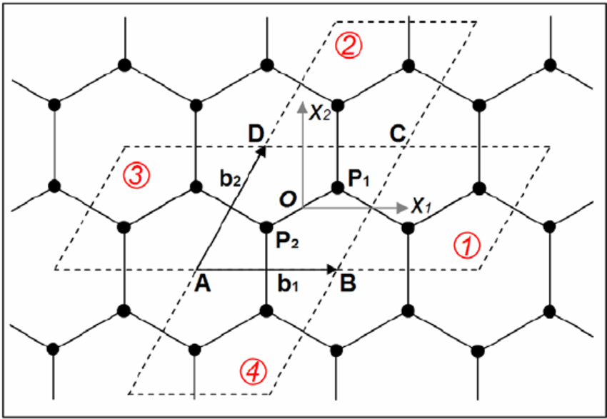

# Graphene

```{seealso}
This tutorial is also available as a runnable
[Google Colab notebook](https://colab.research.google.com/drive/12_ofrjJi4pr6U9j-ER1WocYJkqxEffs-?usp=sharing).
```

Graphene is probably the most famous two-dimensional allotrope within the
carbon material family. The carbon atoms form a 2D sheet of atoms organized
in a honeycomb pattern. From a crystallographic perspective, this system can
be represented using a unit cell containing two atoms, provided the unit
vectors are chosen appropriately:



The two carbon atoms forming the unit cell are commonly referred to as the A
and B sublattice atoms. In pristine graphene they are equivalent, while with
a mass term they become inequivalent: in the first case pristine graphene
behaves as a semimetal, in the second a gap opens in the system. For this
first exercise we will introduce such a mass term.

This exercise is your first experience with the GRABNES code. Several
complexities are hidden away, but you are strongly encouraged to ask
questions or investigate the source code to understand what happens under the
hood.

## Building the system

We use the built-in methods to build the graphene structure. The following
input file builds the structure and the Hamiltonian but does not calculate
any observable. As a power user you would compile the Fortran code on your
own cluster and edit the input file with your favorite terminal editor.

```{important}
The input file `Gendata.in` is not read sequentially by the code, i.e. the
order in which the input flags are provided does not matter. The usual format
is the name of the flag followed by its value (a number, a boolean `.false.`
or `.true.`, a string, or a code block). The parser requires negative values
to be given as `0.0-1.0` instead of `-1.0`.
```

In the Python driver scripts of these tutorials, input flags are collected in
lists of strings and written with `pg.createInputFile()`. Below, `<GRABNES>`
denotes the path to your `grabnes` executable.

```python
import PyToGrabnes as pg

inputStrings_generic = ["Description Generate TB data",  # no need to modify
                        "Prefix generate",              # no need to modify
                        ]

inputStrings_cell = ["TypeOfSystem Graphene",  # build graphene with built-in methods
                     "CellSize 10",            # repetitions of the graphene unit cell
                     "Supercell 1",            # repetitions of the cell in x and y
                     ]

inputStrings_calc = ["Calculate.OnlyDOS .false.",   # DOS by recursion, no time evolution
                     "Kubo.Calc .false.",           # Lanczos and Kubo parts of the code
                     "Diag.Calc .false.",           # exact diagonalization
                     "Calculate.Bands .false.",     # band structure
                     "Calculate.DOS .false.",       #
                     "Calculate.spectral .false.",  #
                     ]

inputStrings_output = ["WriteDataFiles .true.",  # write the Hamiltonian files
                       "WritePos .true.",        # write the structure files
                       ]

inputStrings = (inputStrings_generic + inputStrings_cell
                + inputStrings_calc + inputStrings_output)

pg.createInputFile("Gendata.in", workingDir, inputStrings)
```

```bash
<GRABNES> Gendata.in > out.log
```

```{task} Tasks
- Build the structure by running the code.
- Visualize the structure using the `plotStructure()` method.
- Add the lattice vectors to the system using the `plotLatticeVectors()` method.
```

If the code ran correctly, you should see a graphene structure where the
original graphene unit cell has been repeated `n` times along the $a_1$ and
$a_2$ directions as set by the `CellSize` flag. The `Supercell` flag repeats
the cell defined by the cell size `m` times, making it easy to repeat moiré
cells that are larger than the initial graphene cell. This will be
illustrated in the section on graphene on hBN.

## Electronic structure

We now obtain a few electronic structure observables by flipping the flags in
the `inputStrings_calc` list above and appending two further lists when
concatenating `inputStrings`:

- `inputStrings_ham` controls the tight-binding model used in the
  calculation,
- `inputStrings_neigh` controls which neighbors are included in the model.

To get an accurate graphene band structure we use the F2G2 model proposed in
[_Tight-binding model for graphene $\pi$-bands from maximally localized
Wannier functions_](https://journals.aps.org/prb/abstract/10.1103/PhysRevB.87.195450),
which requires including up to 5th nearest neighbors.

```python
inputStrings_calc = [..., "Diag.Calc .true.", "Calculate.Bands .true.", ...]

inputStrings_neigh = ["Neigh.LayerNeighbors 100",  # large enough to store all
                                                   # neighbors; too small gives a
                                                   # segmentation fault
                      "TB.NeighLevels 5",          # 5 levels required for F2G2
                      "nonBulkSmall .true.",       # less efficient neighbor routine,
                                                   # needed for very small systems
                      "Bulk .false.",              # only for bulk systems
                      ]

inputStrings_diag = ["Bands.NumPoints 10",         # k-points per path segment
                     "&begin Bands.Path 4",        # number of high-symmetry points
                     "0.0   0.0  0.0",             # Gamma, reduced coordinates
                     "0.5   0.0  0.0",             # M
                     "2/3   1/3  0.0",             # K
                     "0.0   0.0  0.0",             # Gamma
                     "&end Bands.Path",
                     ]

inputStrings_ham = ["TB.OnSiteC 0.4914",   # carbon onsite energy (F2G2)
                    "TB.Hopping 3.07504",  # 1st nearest-neighbor hopping (F2G2)
                    "TypeOfSL HTC",        # F2G2 intralayer + TC interlayer
                    ]
```

Run the code, then post-process and plot the bands:

```python
pg.transformBands("generate.bands")
pg.plot_electronic_bandstructure(workingDir, 2, 0.5)
plt.axvline(1.474633, linestyle="dashed", color="grey")
plt.axvline(2.326013, linestyle="dashed", color="grey")
plt.xticks([0.0, 1.474633, 2.326013, 4.028773],
           [r"$\Gamma$", "M", "K", r"$\Gamma$"])
plt.ylabel("E (eV)")
```

If the code ran correctly, you should see the electronic band structure of
single-layer graphene along the path defined in the input file. This band
structure captures the electron–hole asymmetry that is neglected when only
first-nearest-neighbor hopping terms are included: rerun the calculation with
`TB.NeighLevels 1` and compare. The F2G2 model has been optimized to capture
the low-energy states of DFT calculations accurately while limiting the range
of the model.

## Density of states

The DOS can be calculated using Lanczos recursion or exact diagonalization;
the theory of both methods is summarized in {doc}`../theory/observables`.
Note that Lanczos recursion requires a large enough supercell to sample
enough states in real space, similar to the requirement of adding sufficient
k-points for exact diagonalization.

### Lanczos recursion

```python
inputStrings_calc = ["Calculate.OnlyDOS .true.", "Kubo.Calc .true.", ...]

inputStrings_cell = ["TypeOfSystem Graphene", "Supercell 300", "CellSize 1",
                     "oneLayer .true.", ...]

inputStrings_lanczos = ["EnergyMin 0.0-12.0",   # minimum energy for plotting
                        "EnergyMax 12.0",       # maximum energy for plotting
                        "NumberOfRecursion 1000",  # number of recursion steps
                        ]
```

```python
pg.plotDOS("generate.DOS")
```

```{task} Tasks
- Run this calculation for a few different supercell sizes and observe how
  the DOS changes. On Google Colab hardware, limit yourself to `CellSize 500`
  (this corresponds to $2 \times 500 \times 500 = 500\,000$ atoms).
- Calculate the same DOS using exact diagonalization and compare with the
  previous results.
```

The larger system gives a much smoother curve for a fixed number of
recursion steps and energy broadening.

### Exact diagonalization

The choice between Lanczos and exact diagonalization depends on the system
size: exact diagonalization is more accurate but scales poorly (limited to
~10,000 atoms on a low-memory machine, ~50,000 on a high-memory machine),
while Lanczos easily deals with systems of 20 million atoms on a low-memory
machine. For the current small system, both methods can be used:

```python
inputStrings_calc = ["Diag.Calc .true.", "Calculate.DOS .true.", ...]

inputStrings_diag = ["KGrid 37 37 1",        # Monkhorst-Pack grid
                     "Epsilon 0.1",          # energy broadening
                     "NumberofEnergyPoints 1000",
                     "DOS.Emin 0.0-15.0",
                     "DOS.Emax 15.0",
                     ]
```

```python
pg.plotDOS("generate.diag.DOS")
```

Both approaches should give similar results at the same energy resolution.

```{task} Tasks
- Modify the resolution of the DOS by changing the value of `Epsilon`.
- Add a gap to the system using the `addSublatticeMassterm .true.` and
  `sublatticeMassterm 1.0` flags, and plot the gapped band structure:
```

```python
inputStrings_ham = ["TB.OnSiteC 0.4914",
                    "TB.Hopping 3.07504",
                    "TypeOfSL HTC",
                    "addSublatticeMassterm .true.",
                    "sublatticeMassterm 1.0",
                    ]
```

## Next steps

- {doc}`bilayer-graphite` — Bernal bilayer graphene and bulk graphite, and
  the `ReadXYZ` method for reading structures from external files.
- {doc}`tbg` — twisted bilayer graphene and commensurate moiré cells.
